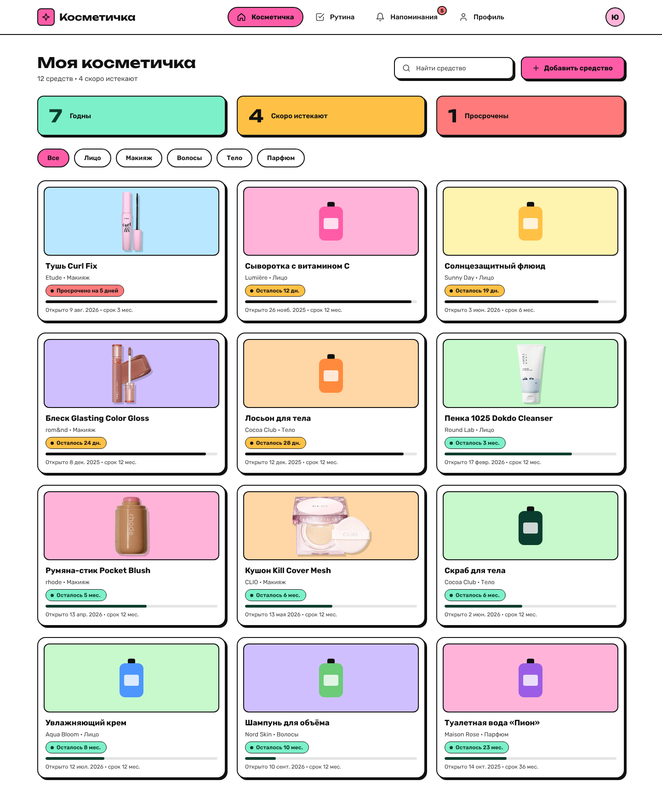
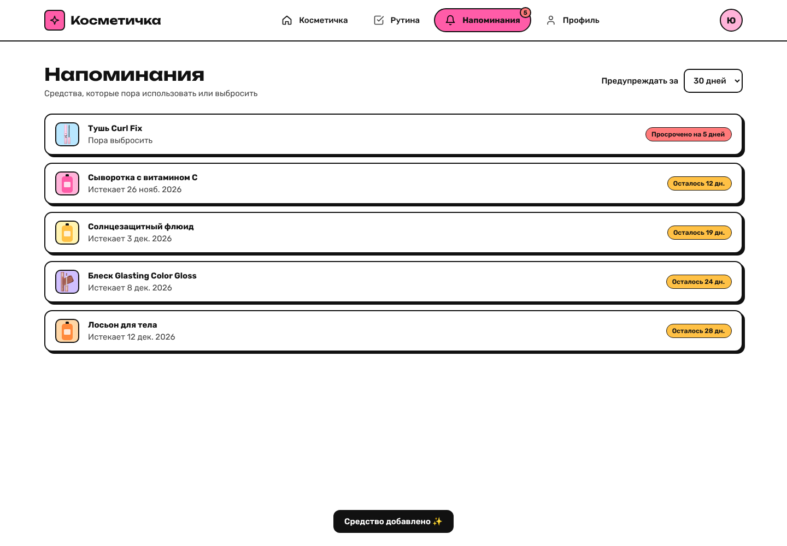
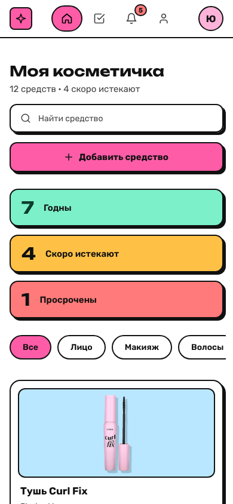

# Косметичка — трекер сроков годности

Фронтенд-прототип веб-приложения, которое помогает следить за сроком годности косметики после вскрытия.
Сайт свёрстан по собственному макету в Figma (стиль «Поп»: яркие цвета, толстые обводки, жёсткие тени).



## Возможности

- **Косметичка.** Карточки средств со статусом (годно, скоро истекает, просрочено), полоской прошедшего срока и датой вскрытия.
- **Сводка.** Счётчики по статусам; клик по счётчику фильтрует список.
- **Поиск и категории.** Лицо, макияж, волосы, тело, парфюм.
- **Добавление, редактирование, удаление.** Модальное окно с живым превью флакона и выбором цвета.
- **Фото средства (необязательно).** Загруженное фото сжимается через `<canvas>` до 640 px и сохраняется в браузере; без фото показывается нарисованный флакон. В демо-данных у части средств уже есть фото.
- **Напоминания.** Список истекающих средств и настройка «предупреждать за 14 / 30 / 60 дней».
- **Рутина.** Утренний и вечерний чек-лист на сегодня, сбрасывается каждый день.
- **Профиль.** Имя, статистика, сброс демо-данных.
- Данные сохраняются в `localStorage`, сервер не нужен.
- Адаптивная вёрстка: ПК, планшет, телефон.

| Напоминания | Телефон |
|---|---|
|  |  |

## Демо

Сайт опубликован на GitHub Pages: https://yuwnxu.github.io/cosmetichka/

## Технологии

- HTML5 (семантическая разметка, `<dialog>`)
- CSS3 (переменные-токены, Grid, Flexbox, анимации, медиазапросы)
- JavaScript без фреймворков (хеш-роутинг, рендер шаблонами, `localStorage`)
- Figma: макет и иконки

## Структура

```
index.html        — разметка всех страниц и модального окна
css/style.css     — стили и адаптив
js/data.js        — категории, палитра, демо-данные
js/utils.js       — даты, склонения, хранилище
js/app.js         — состояние, отрисовка, обработчики событий
assets/icons/     — иконки из макета
assets/photos/    — фото для демо-данных (вырезки на прозрачном фоне, WebP)
```

## Как запустить

Откройте `index.html` в браузере или запустите локальный сервер:

```bash
python -m http.server 8000
```

и перейдите на http://localhost:8000.

## Как считается срок

Срок истекает через выбранное количество месяцев после даты вскрытия.
Если осталось меньше дней, чем указано в настройке напоминаний (по умолчанию 30), средство попадает в «Скоро истекают».
Демо-данные строятся от сегодняшней даты, поэтому в прототипе всегда видны все три статуса.
